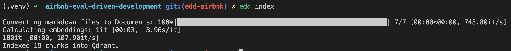
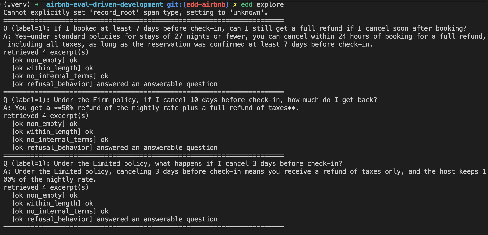
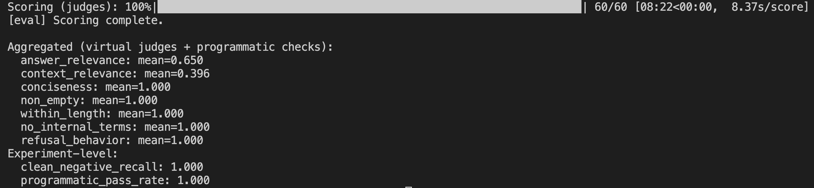
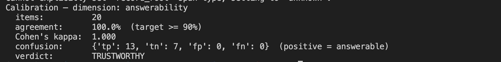
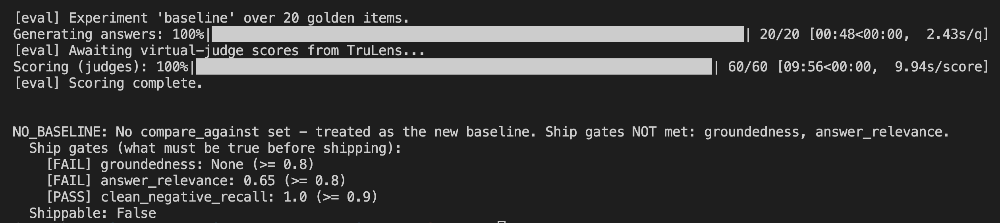
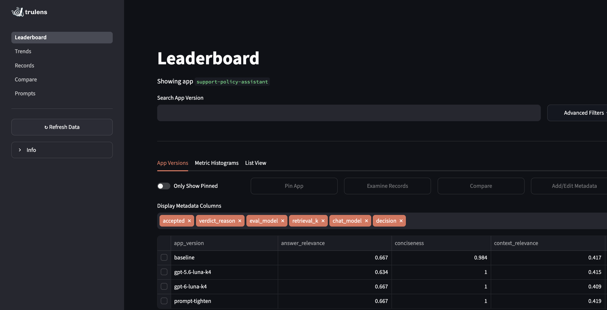
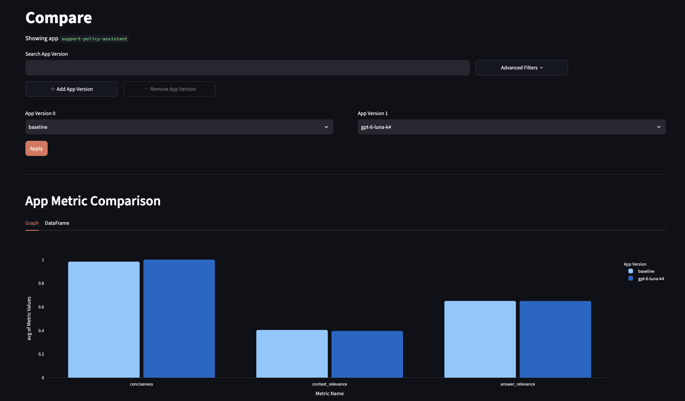

# Eval-Driven Development — Haystack × Qdrant × TruLens

A faithful, runnable replication of Airbnb's
[**Eval-driven development: Lessons from evaluating GenAI at scale**](https://medium.com/airbnb-engineering/eval-driven-development-lessons-from-evaluating-genai-at-scale-e817e5ae5788),
built on the walkthrough scenario from the post:

> *"You're building an AI assistant that answers questions about a travel
> platform's support policies."*

The assistant is a RAG pipeline over a corpus of **real Airbnb support policies**,
collected verbatim from the Airbnb Help Center:

- **Cancellation policies & refunds** — [article 475](https://www.airbnb.com/help/article/475)
- **AirCover for guests** — [article 3218](https://www.airbnb.com/help/article/3218),
  [article 170](https://www.airbnb.com/help/article/170)
- **Host payouts** — [article 92](https://www.airbnb.com/help/article/92),
  [article 425](https://www.airbnb.com/help/article/425)
- **Major Disruptive Events Policy** — [article 1320](https://www.airbnb.com/help/article/1320)
- **Service fees** — [article 1857](https://www.airbnb.com/help/article/1857)
- **Reviews** — [article 367](https://www.airbnb.com/help/article/367)
- **Changing a reservation** — [article 913](https://www.airbnb.com/help/article/913),
  [article 1505](https://www.airbnb.com/help/article/1505)

Every question in the golden set is grounded in these documents (with exact
numbers — 72-hour AirCover windows, the 1.5% / $15 Fast Pay fee, the Firm
7-to-30-day 50% rule, the 14.1%–16.5% guest service fee, the 14-day review window,
and so on), and the clean negatives ask about things these policies genuinely
don't cover (loyalty points, pet fees, crypto payments, cleaning-fee caps).
Evaluation is treated as a first-class engineering discipline, implemented as the
blog's three layered defenses and its keep/reject experiment loop.

## Stack

| Concern | Tool |
| --- | --- |
| Orchestration (indexing + RAG) | **Haystack 3.x** (deepset) |
| Vector database | **Qdrant Cloud** |
| Virtual judges, tracing, dashboard | **TruLens** |
| Generator under test / judge model | OpenAI (`gpt-6-luna` / `gpt-6-luna`) |

## The three evaluation layers (from the blog)

```
Layer 1  Programmatic & heuristic checks   fast, free, catches obvious failures   edd/programmatic.py
             ↓
Layer 2  Virtual judges (LLM-as-judge)     nuanced quality dimensions             edd/judges.py
             ↓
Layer 3  Human evaluation & calibration    validates & calibrates the stack       edd/calibration.py
```

- **Layer 1 — programmatic**: deterministic checks (presence, length bounds, no
  leaked internal terms, and correct *refusal behavior* on clean negatives). No
  LLM call, so it filters the obvious failures before any judge spends a token.
- **Layer 2 — virtual judges**: a small, sharp panel — **one evaluator per
  dimension**, no "God evaluator" — judged by a *different, stronger* model than
  the generator. **answer_relevance** and **context_relevance** plus a
  product-specific **conciseness** judge. Every
  score carries a chain-of-thought reason.
- **Layer 3 — calibration**: a judge you haven't calibrated gives false
  confidence. `edd calibrate` runs the answerability judge against the human
  labels in the golden set and reports **% agreement** and **Cohen's kappa**,
  listing disagreements to analyze. Target the high 80s–90s before trusting a
  judge at scale.

## Setup

### 1. Install

```sh
cd airbnb-eval-driven-development
uv venv
source .venv/bin/activate
uv pip install -e .
```

### 2. Credentials

```sh
cp .env.example .env
```

Fill in your three credentials (and nothing else — these are the only values the
code reads from the environment):

```
OPENAI_API_KEY=sk-...
QDRANT_URL=https://<your-cluster>.cloud.qdrant.io:6333
QDRANT_API_KEY=<your-qdrant-cloud-api-key>
```

> `QDRANT_URL` and `QDRANT_API_KEY` come from your **Qdrant Cloud** cluster
> (Clusters → your cluster → *Details* for the URL, *API Keys* for the key).

### 3. Index the corpus into Qdrant

```sh
edd index
```

Re-run whenever `chunk_size`, `chunk_overlap`, the embedding model, or the
documents under [data/support_policies/](data/support_policies/) change.



---

## The eval-driven loop

### Step 1 — Explore & discover ("look at your data")

Before building any metric, read the outputs and traces.

```sh
edd golden          # validate the gold set (positives + clean negatives)
edd explore         # generate answers for every gold-set question and read them
edd ask "how long do refunds take?"
```



### Step 2 — Evaluate across all three layers

```sh
edd evaluate        # Layer 1 + Layer 2 over the gold set, with clean-negative recall
```



### Step 3 — Calibrate the virtual judge (Layer 3)

```sh
edd calibrate --target 0.9    # % agreement + Cohen's kappa vs. human labels (default target 0.85)
```



If agreement is below target, analyze the printed disagreements, sharpen the
rubric / few-shots in [src/edd/calibration.py](src/edd/calibration.py), and re-run
until the judge is trustworthy.

### Step 4 — Set goals & gates upfront, then iterate one variable at a time

[evals/experiment_plan.json](evals/experiment_plan.json) sets absolute ship gates
decided *before* iterating, and tags each experiment with the one `varies` knob it
changes (prompt → serving config):

```json
"gates": { "answer_relevance": 0.8, "clean_negative_recall": 0.9 }
```

`edd run <name>` evaluates one experiment, compares its metrics to the baseline,
checks the ship gates, and lets **Git enforce the verdict**:

```sh
edd run baseline         # defines the benchmark
edd run prompt-tighten   # vary the prompt
edd run retrieval-k2     # vary the serving config
```



- **Keep** — every metric flat-or-better vs. baseline → source change + snapshot committed.
- **Reject** — any metric regressed → `src/` reverted; only the result record is committed.
- **Shippable** — a kept candidate that *also* clears every absolute ship gate.
- **Plateau** — two consecutive flat keeps → warns that a structural change is needed.

> `edd run` makes real commits to enforce keep/reject, scoped to `src/` and `evals/`.
> This folder lives inside the shared `case-study-series` repo, so commits land there;
> copy it into its own repo first if you want isolated history.

### Step 5 — Inspect failures

```sh
edd report retrieval-k2                      # worst cases + judge chain-of-thought
edd report retrieval-k2 --metric answer_relevance --worst 3
```

### Step 6 — Mirror the evals in production

Evaluation is never one-and-done. `edd monitor` samples a fraction of a
de-identified traffic log ([evals/production_traffic.jsonl](evals/production_traffic.jsonl)),
runs the Layer-1 checks plus the answerability judge over each sampled query, and
surfaces flagged outputs (including likely fabrications) for human review.

```sh
edd monitor --sample-rate 0.3
```

### Dashboard

```sh
edd dashboard        # TruLens UI
```

Explore records, span timelines, feedback scores, and the experiment leaderboard
(each experiment carries its keep/reject `decision` as metadata).





---
